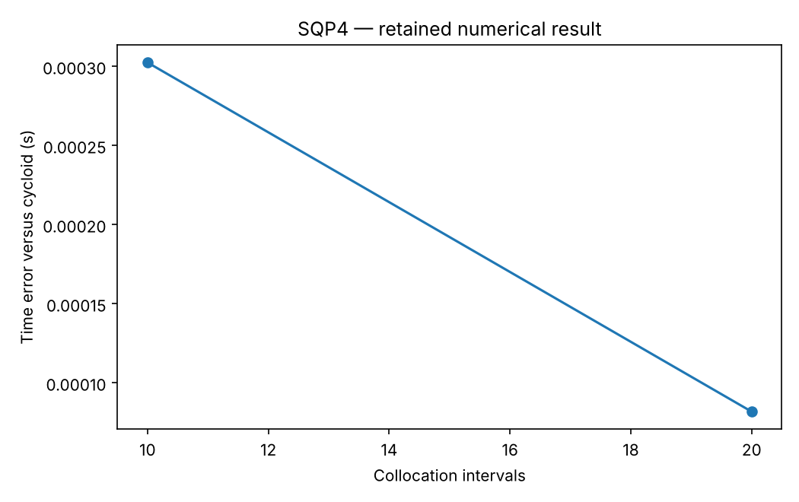

# SQP4: Optimal control by collocation and independent replay

This chapter runs native Rust solvers through their Python APIs. Its model and independent checks live in this directory; the shared driver in optimization-jobs adds figures and command-job execution.

## Model and decision

Transcribe the brachistochrone with states x,y,v, control theta and free final time, then reuse the existing Bryson-Ho orbit-radius Python model without changing its equations. Both use trapezoidal defects and analytic sparse derivatives.

## Work through the lesson

For the brachistochrone, states $(x,y,v)$ use downward-positive $y$ and angle control $\theta$:

$$\dot x=v\sin\theta,\quad\dot y=v\cos\theta,\quad\dot v=g\cos\theta.$$

Time is scaled to $[0,1]$ and final time is a decision. Trapezoidal defects enforce adjacent-node dynamics; they do not guarantee the interpolated path satisfies the ODE between nodes.

1. Solve 10 and 20 intervals, then 40 in study. Compare with cycloid time 0.5828954632 s; the retained smoke times are about 0.5831980 and 0.5829773 s.
2. Interpolate the control and replay with independent DOP853, retaining endpoint errors separately from defects. The check requires both the descent-time error and the replayed endpoint error to shrink with each finer mesh. At zero initial speed, $\theta$ still affects acceleration through $g\cos\theta$.
3. Import the orbit-radius model from `examples/orbit_transfer.py`. Check its derivatives and KKT residuals independently; the 20- and 40-interval final radii, about 1.52206048 and 1.52448724, match the SLSQP values in that file to its five decimals, and study adds 60 intervals. Replay the thrust angle unwrapped (it crosses ±π) and compare the replayed radius and the terminal radial velocity and circular-speed residuals with the collocation values. The replayed radius error falls from about 8e-3 (20 intervals) to 3e-3 and 1e-3. Mesh-dependent values are compared at the same mesh, not silently against a continuous optimum.

## Run

Install the pinned solver packages and scientific dependencies as described in the [shared setup](https://github.com/dietmarwo/optimization-jobs/blob/main/tutorials/structured/README.md), with the repositories it lists cloned side by side. From this repository's root:

```bash
python ../optimization-jobs/tutorials/structured/run.py --chapter SQP4 --output /absolute/new/sqp4
```

To run the chapter on its own, use `python tutorials/collocation/run.py --preset smoke --output /absolute/new/sqp4-direct`. It produces JSON; the shared driver additionally renders PNG/SVG figures. `--preset study` runs the larger declared cases; a chapter without them repeats the smoke case. Output may be new or empty, and an occupied directory is refused.

## Independent answer and validation

Cycloid descent time is 0.5828954632 seconds. Smoke solves 10/20 bead intervals and the 20-interval orbit; study reaches bead 40 and orbit 40/60. Independent SciPy DOP853 integration replays each control and reports endpoint differences separately from defects.

Every run keeps the native status, points and available diagnostics. SQP results keep their derivative checks and independently reconstructed KKT residuals. Application-specific references are computed separately. All failures remain in the report.

## Read the result

Read `summary.json` before interpreting `figure.png`. The report records the actual result; expected reference values are not substituted for missing numerical outcomes. A completed command job means that the chapter's executable checks completed, while individual solver attempts can still be nonconvergent where the lesson explicitly retains them.

The initial bead control affects acceleration even when speed is zero. Mesh feasibility is not continuous-trajectory accuracy; the orbit remains a development example, not the unavailable application target.

## Agent prompt

> Transcribe the brachistochrone and supplied orbit-radius transfer by collocation. Refine the meshes, compare like-for-like references, and independently integrate the controls. Keep defects and physical replay errors separate.

Use the complete [prompt](prompt.md) for the workflow and evidence requirements.

## Follow-up exercise

Omit the free-time factor or flip a gravity sign in a test copy and check the replay. Compare refinement with merely tightening solver tolerances.

## Provenance and limits

The checked-in `results/` record one run of each preset. The shared driver writes source and package identities to `environment.json` for the runs it makes. These are reproducible teaching experiments, not industrial or hardware performance certifications. Tables that compare formulations or solvers are descriptive.

## Recorded example



Inspect the [complete smoke summary](results/smoke/summary.json) alongside the figure.

The [study summary](results/study/summary.json) and [study figure](results/study/figure.png) record the study preset.
