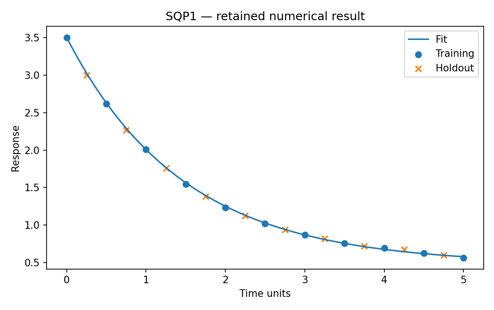

# SQP1: Constrained calibration and checked derivatives

This chapter runs native Rust solvers through their Python APIs. Its model and independent checks live in this directory; the shared driver in optimization-jobs adds figures and command-job execution.

## Model and decision

Fit y=a*exp(-b*t)+c by half the sum of squared training residuals, with 0<=a<=10, 0<=b<=5, -5<=c<=5. The curve must pass through the training row at t=1. The data file is the one the job-API tutorial uses (`tutorials/job-api/decay.csv`).

## Work through the lesson

With residual $r_i=a e^{-bt_i}+c-y_i$, minimize $\tfrac12\sum_{i\in\mathcal T}r_i^2$ subject to the stated boxes and $a e^{-b}+c=y(1)$. Even-index CSV rows train; odd-index rows are held out.

1. Differentiate the residual: $\partial r/\partial(a,b,c)=(e^{-bt},-at e^{-bt},1)$. Supply the objective gradient and anchor Jacobian, then check both before solving.
2. Eliminate $c=y(1)-ae^{-b}$. For each $b$, solve the remaining bounded scalar least-squares problem in $a$, then minimize the profile in $b$. The recorded reference is $b\approx0.6824162$ with training loss about $8.37466\times10^{-4}$.
3. Compare four starts and both QP backends using the reconstructed constrained KKT residuals. Retain native status and holdout errors rather than selecting by the training objective alone.
4. Inspect the separate noiseless known-answer fixture. An exact anchor is appropriate there; treating one arbitrary noisy measurement as exact changes the statistical assumptions.

## Run

Install the pinned solver packages and scientific dependencies as described in the [shared setup](https://github.com/dietmarwo/optimization-jobs/blob/main/tutorials/structured/README.md), with the repositories it lists cloned side by side. From this repository's root:

```bash
python ../optimization-jobs/tutorials/structured/run.py --chapter SQP1 --output /absolute/new/sqp1
```

To run the chapter on its own, use `python tutorials/constrained-calibration/run.py --preset smoke --output /absolute/new/sqp1-direct`. It produces JSON; the shared driver additionally renders PNG/SVG figures. `--preset study` runs the larger declared cases; a chapter without them repeats the smoke case. Output may be new or empty, and an occupied directory is refused.

## Independent answer and validation

Analytic gradients and the anchor Jacobian pass finite differences. Four starts and both QP backends are retained. A reduced one-dimensional reference eliminates the anchor and optimizes amplitude analytically for each decay rate. A separate noiseless fixture has known zero loss; holdout rows never enter fitting.

Every run keeps the native status, points and available diagnostics. SQP results keep their derivative checks and independently reconstructed KKT residuals. Application-specific references are computed separately. All failures remain in the report.

## Read the result

Read `summary.json` before interpreting `figure.png`. The report records the actual result; expected reference values are not substituted for missing numerical outcomes. A completed command job means that the chapter's executable checks completed, while individual solver attempts can still be nonconvergent where the lesson explicitly retains them.

KKT is reconstructed with the direct API's multipliers. A small gradient alone is insufficient for constrained stationarity. A finite reference grid is not a certified global proof.

## Agent prompt

> Fit the supplied exponential decay data with the stated exact anchor. Supply and check derivatives, compare starts/backends, validate against the reduced reference, and report training and held-out error separately.

Use the complete [prompt](prompt.md) for the workflow and evidence requirements.

## Follow-up exercise

Use another retained training anchor. Explain why the problem changed and why a trusted exact anchor may be inappropriate when every measurement is noisy.

## Provenance and limits

The checked-in `results/` record one run of each preset. The shared driver writes source and package identities to `environment.json` for the runs it makes. These are reproducible teaching experiments, not industrial or hardware performance certifications. Tables that compare formulations or solvers are descriptive.

## Recorded example



Inspect the [complete smoke summary](results/smoke/summary.json) alongside the figure.

The [study summary](results/study/summary.json) and [study figure](results/study/figure.png) record the study preset.
