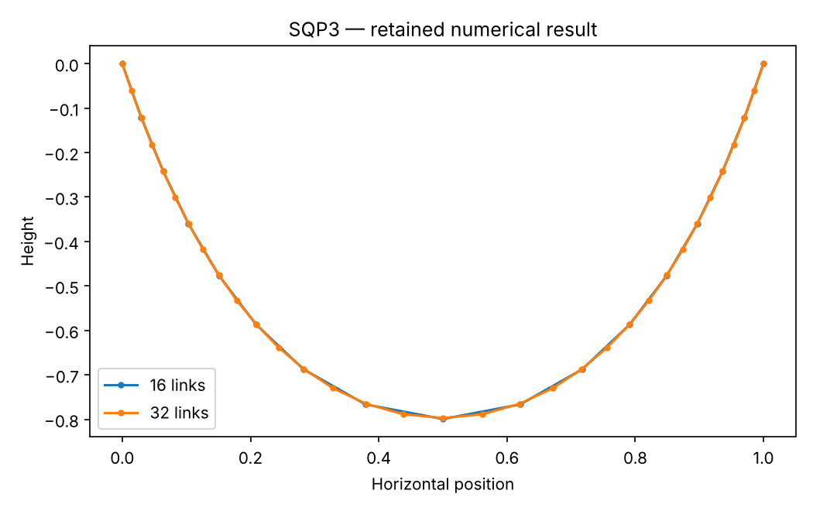

# SQP3: Hanging chain: separate mesh and solver error

This chapter runs native Rust solvers through their Python APIs. Its model and independent checks live in this directory; the shared driver in optimization-jobs adds figures and command-job execution.

## Model and decision

Uniform rigid links span one unit with total length two. Minimize gravitational potential subject to squared link-length equalities. The interior coordinates give 2(N-1) variables and a sparse banded Jacobian.

## Work through the lesson

For $N$ uniform rigid links of total length $L=2$ spanning $D=1$, optimize the $2(N-1)$ interior coordinates:

$$\min\sum_{i=0}^{N-1}\frac{L}{2N}(y_i+y_{i+1}),\qquad
(x_{i+1}-x_i)^2+(y_{i+1}-y_i)^2=(L/N)^2.$$

1. Check the banded constraint Jacobian and solve smoke meshes 16 and 32. Link lengths and KKT residuals assess the discretized optimization.
2. Independently solve one scalar horizontal-tension equation for the exact discrete equilibrium. Objective disagreement with that reference is solver error.
3. Compare the discrete reference with the continuum catenary: $a=0.229640215078$, potential approximately -0.911208463318. This difference is discretization error. Study continues through 64 and 128 links; compare the actual errors before claiming an observed order.
4. The implementation records the hard dimension boundary explicitly: 129 links use 256 variables; 128 is the largest admissible power-of-two mesh. The reflected arch and additional warm-start experiments remain follow-up exercises.

## Run

Install the pinned solver packages and scientific dependencies as described in the [shared setup](https://github.com/dietmarwo/optimization-jobs/blob/main/tutorials/structured/README.md), with the repositories it lists cloned side by side. From this repository's root:

```bash
python ../optimization-jobs/tutorials/structured/run.py --chapter SQP3 --output /absolute/new/sqp3
```

To run the chapter on its own, use `python tutorials/hanging-chain/run.py --preset smoke --output /absolute/new/sqp3-direct`. It produces JSON; the shared driver additionally renders PNG/SVG figures. `--preset study` runs the larger declared cases; a chapter without them repeats the smoke case. Output may be new or empty, and an occupied directory is refused.

## Independent answer and validation

An independent one-dimensional tension solve gives exact discrete equilibrium; the catenary gives the continuum reference. Smoke runs 16/32 links; study adds 64/128. Their potential differences separate numerical convergence from discretization error.

Every run keeps the native status, points and available diagnostics. SQP results keep their derivative checks and independently reconstructed KKT residuals. Application-specific references are computed separately. All failures remain in the report.

## Read the result

Read `summary.json` before interpreting `figure.png`. The report records the actual result; expected reference values are not substituted for missing numerical outcomes. A completed command job means that the chapter's executable checks completed, while individual solver attempts can still be nonconvergent where the lesson explicitly retains them.

Every recorded mesh converges from its declared start, and each objective is compared with the exact discrete reference. Keep in mind that an infeasible point can have an objective below the true minimum, so an objective alone is no evidence.

## Agent prompt

> Solve the hanging chain on the declared meshes. Use the exact discrete equilibrium and continuum catenary to separate solver error from discretization error. State the dimension limit without confusing 128 with 129 links.

Use the complete [prompt](prompt.md) for the workflow and evidence requirements.

## Follow-up exercise

Reflect a solution upward and inspect first-order conditions. Explain why 128 is the largest power-of-two mesh here, while the exact 256-variable limit permits 129 links.

## Provenance and limits

The checked-in `results/` record one run of each preset. The shared driver writes source and package identities to `environment.json` for the runs it makes. These are reproducible teaching experiments, not industrial or hardware performance certifications. Tables that compare formulations or solvers are descriptive.

## Recorded example



Inspect the [complete smoke summary](results/smoke/summary.json) alongside the figure.

The [study summary](results/study/summary.json) and [study figure](results/study/figure.png) record the study preset.
