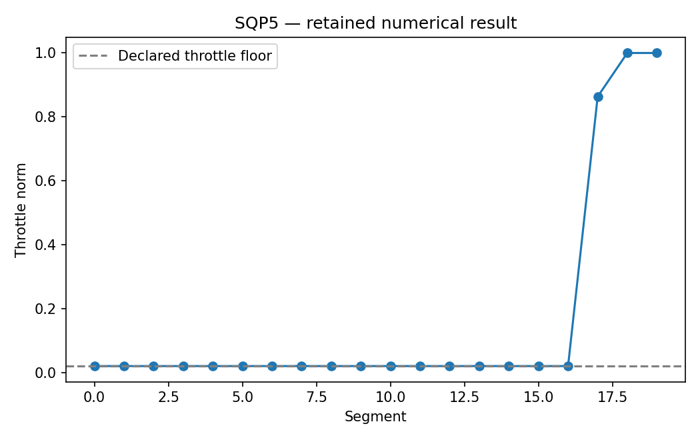

# SQP5: Earth-Mars rendezvous with pykep-core

This chapter runs native Rust solvers through their Python APIs. Its model and independent checks live in this directory; the shared driver in optimization-jobs adds figures and command-job execution.

## Model and decision

A fixed 300-day leg departs at MJD2000 9800. Ephemerides are converted from SI to AU-based canonical units. Optimize 20 throttle vectors, arrival mass and bounded departure excess velocity; study uses 40 segments. pykep supplies mismatch values and analytic Jacobians.

## Work through the lesson

The fixed 300-day leg departs at MJD2000 9800. Built-in Earth/Mars ephemerides freeze its endpoints. There are $3N$ throttle components, the normalized arrival mass and three bounded departure excess-velocity components, seven mismatch equalities and $N$ throttle-norm upper bounds. Units are AU, the matching time unit $\sqrt{\mathrm{AU}^3/\mu_\odot}$ (about 58.1 days) and the initial mass of 1,000 kg. The maximum thrust 0.12 in these units is about 0.71 N, and the exhaust velocity is 30 km/s (specific impulse about 3,060 s).

1. Form a Lambert-informed start and check the derivatives in nondimensional units: the mismatch Jacobian is pykep-core's analytic one, and the throttle-norm rows $2u_i$ are written in the chapter. The Lambert impulse is context, not a low-thrust bound.
2. Keep `original_coast_model`: allowing zero throttle reaches an iteration limit near the nonsmooth coast region. A failed first-order solve is not evidence that rendezvous is physically impossible.
3. Declare a separate model with $\|u_i\|\ge0.02$. Smoke has 20 segments and converges to normalized arrival mass about 0.900114 for an initial 1,000 kg. It does not solve the original coast-permitting formulation by assertion.
4. Replay each impulsive midpoint segment with independent two-body DOP853 and the mass update; inspect mismatch in km and m/s. The native fixed Sims–Flanagan leg uses Lagrangian Kepler drifts with analytic STM Jacobians. Study uses 40 segments.

## Run

Install the pinned solver packages and scientific dependencies as described in the [shared setup](https://github.com/dietmarwo/optimization-jobs/blob/main/tutorials/structured/README.md), with the repositories it lists cloned side by side. From this repository's root:

```bash
python ../optimization-jobs/tutorials/structured/run.py --chapter SQP5 --output /absolute/new/sqp5
```

To run the chapter on its own, use `python tutorials/low-thrust-pykep/run.py --preset smoke --output /absolute/new/sqp5-direct`. It produces JSON; the shared driver additionally renders PNG/SVG figures. `--preset study` runs the larger declared cases; a chapter without them repeats the smoke case. Output may be new or empty, and an occupied directory is refused.

## Independent answer and validation

A Lambert-informed start is declared. The model permitting exact coasts can stall near zero throttle; its full outcome is retained. A separate model requires throttle norm >=0.02, converges and is checked by an independent forward/backward midpoint-impulse replay using SciPy DOP853.

Every run keeps the native status, points and available diagnostics. SQP results keep their derivative checks and independently reconstructed KKT residuals. Application-specific references are computed separately. All failures remain in the report.

## Read the result

Read `summary.json` before interpreting `figure.png`. The report records the actual result; expected reference values are not substituted for missing numerical outcomes. A completed command job means that the chapter's executable checks completed, while individual solver attempts can still be nonconvergent where the lesson explicitly retains them.

The throttle-floor result is not a solution of an identical coast-permitting formulation. Report nonsmoothness and actual convergence. This example does not establish GTOC/SNOPT application readiness.

## Agent prompt

> Find a low-thrust Earth–Mars rendezvous for the fixed epoch and flight time using pykep-core derivatives. Retain the original coast-model outcome and treat a minimum-throttle-norm alternative as a distinct model. Replay each segment and report physical mismatch units.

Use the complete [prompt](prompt.md) for the workflow and evidence requirements.

## Follow-up exercise

Compare the two declared models and the extra fuel cost of excluding exact coasts. Inspect physical mismatch units and the forward/backward cut.

## Provenance and limits

The checked-in `results/` record one run of each preset. The shared driver writes source and package identities to `environment.json` for the runs it makes. These are reproducible teaching experiments, not industrial or hardware performance certifications. Tables that compare formulations or solvers are descriptive.

## Recorded example



Inspect the [complete smoke summary](results/smoke/summary.json) alongside the figure.

The [study summary](results/study/summary.json) and [study figure](results/study/figure.png) record the study preset.
