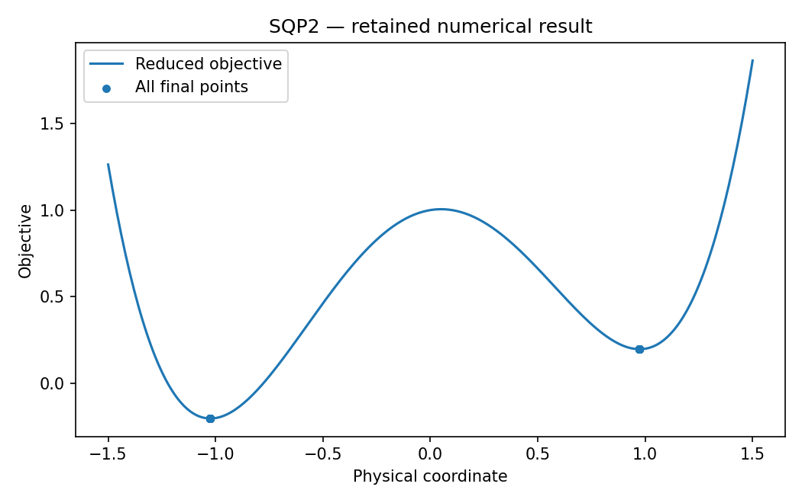

# SQP2: Multistart, units and QP backends

This chapter runs native Rust solvers through their Python APIs. Its model and independent checks live in this directory; the shared driver in optimization-jobs adds figures and command-job execution.

## Model and decision

The simplex calibration minimizes sum(x_i^2) on four nonnegative shares summing to one. The diagnostic problem is (x^2-1)^2+(y-x)^2+0.2*x with y=x and [-2,2] bounds. Compare balanced and deliberately scaled presentations, with identical physical starts.

## Work through the lesson

The physical problem is

$$\min (x^2-1)^2+(y-x)^2+0.2x,\qquad y-x=0.$$

On the feasible line, stationary points solve $4x(x^2-1)+0.2=0$. Root isolation supplies the two minima and intervening maximum independently.

1. Run four physical starts through each backend and scaling choice. In smoke this gives 32 double-well solves; study also includes the `linear` scaling mode.
2. Change coordinates with $(x,y)=Du$ and multiply the equality by $R$. The physical feasible set is unchanged, but gradients, multipliers and stopping scales transform. Check stationarity after mapping back to physical units.
3. Read `claim_counts`. In the ill-scaled representation most solves report `first_order` in the submitted coordinates, yet fail the physical-unit check after mapping back: their physical stationarity lies above 1e-6. `physical_claim` records the weaker conclusion next to the native claim, which is kept as it is.
4. The separate simplex runs (a corner start and a start outside the equality) reach the uniform point with objective 1/4. No bound is active there; the gradient $(1/2,\dots,1/2)$ is balanced by the equality multiplier, so a plain gradient norm would wrongly suggest a nonstationary point.
5. Set the tilt to zero and start at the origin. It is first order but is a maximum along the feasible line. The implementation retains this counterexample instead of interpreting convergence as a minimum certificate.

## Run

Install the pinned solver packages and scientific dependencies as described in the [shared setup](https://github.com/dietmarwo/optimization-jobs/blob/main/tutorials/structured/README.md), with the repositories it lists cloned side by side. From this repository's root:

```bash
python ../optimization-jobs/tutorials/structured/run.py --chapter SQP2 --output /absolute/new/sqp2
```

To run the chapter on its own, use `python tutorials/multistart-scaling/run.py --preset smoke --output /absolute/new/sqp2-direct`. It produces JSON; the shared driver additionally renders PNG/SVG figures. `--preset study` runs the larger declared cases; a chapter without them repeats the smoke case. Output may be new or empty, and an occupied directory is refused.

## Independent answer and validation

Simplex value is 0.25. Cubic root bracketing identifies two minima and a stationary maximum in the double well. The smoke matrix has 32 double-well solves, four simplex solves and an alpha-zero stationary-point demonstration. Native and physical-unit KKT checks are both retained.

Every run keeps the native status, points and available diagnostics. SQP results keep their derivative checks and independently reconstructed KKT residuals. Application-specific references are computed separately. All failures remain in the report.

## Read the result

Read `summary.json` before interpreting `figure.png`. The report records the actual result; expected reference values are not substituted for missing numerical outcomes. A completed command job means that the chapter's executable checks completed, while individual solver attempts can still be nonconvergent where the lesson explicitly retains them.

Internal solver scaling is distinct from changing model units. Absolute tolerances change meaning across coordinates, so conclusions need the canonical physical check. Tiny models do not establish a backend speed ranking.

## Agent prompt

> Solve the tilted double well from multiple physical starts, then change coordinate units and equality-row scale. Map points and multipliers back to physical units and explain why a first-order point can still be a maximum.

Use the complete [prompt](prompt.md) for the workflow and evidence requirements.

## Follow-up exercise

Inspect the alpha-zero point (0,0): first-order conditions hold but it is not a minimum. Corrupt a multiplier or omit its coordinate transformation and check the result.

## Provenance and limits

The checked-in `results/` record one run of each preset. The shared driver writes source and package identities to `environment.json` for the runs it makes. These are reproducible teaching experiments, not industrial or hardware performance certifications. Tables that compare formulations or solvers are descriptive.

## Recorded example



Inspect the [complete smoke summary](results/smoke/summary.json) alongside the figure.

The [study summary](results/study/summary.json) and [study figure](results/study/figure.png) record the study preset.
