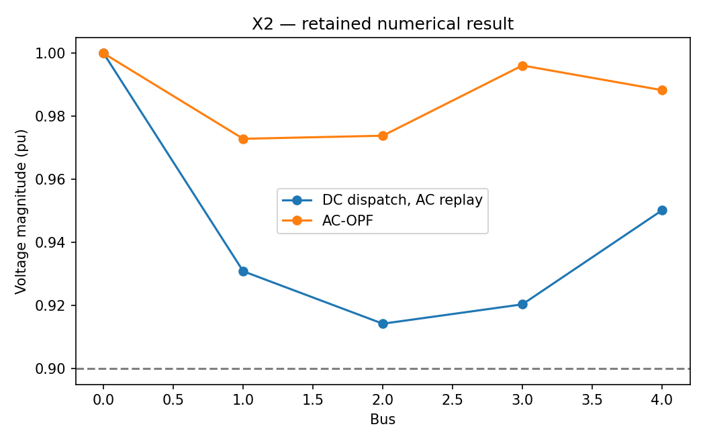

# X2: Power dispatch: DC LP versus AC physics

This executable chapter uses the existing native Rust solver through its Python API. The numerical definitions live with this chapter's owner; the shared driver supplies orchestration and figures.

## Model and decision

A declared synthetic five-bus network has two generators. DC-OPF uses linear angle/flow equations. AC-OPF includes voltage magnitudes, active/reactive generation, nonlinear balance and squared apparent-power limits.

## Work through the lesson

DC-OPF linearizes voltage around unit magnitude and small phase differences. AC-OPF instead enforces complex power balance

$$P_i+\mathrm{i}Q_i=V_i\overline{(YV)_i}.$$

The frozen five-bus data include branch impedances and limits, active/reactive demand, voltage bounds and generator costs.

1. Solve the DC LP, then replay that active dispatch with an independent AC power flow. Let the slack generator absorb losses; inspect the resulting voltage, flow, reactive-power and generator-limit checks.
2. Solve the smooth AC problem and reconstruct KKT. Recorded cost is about 2.232961 versus DC's 2.2; these are different models, so the difference is not an optimizer ranking.
3. Independently rebuild the complex admittance calculation and recompute all balance rows. The retained maximum balance mismatch is about $3.6\times10^{-12}$ in the model's per-unit system.
4. A converged AC solution is a checked first-order point. Global certification would require additional methods; the DC optimum does not certify the nonconvex AC optimum.

## Run

Install the pinned solver distributions and scientific dependencies using the [shared setup](https://github.com/dietmarwo/optimization-jobs/blob/main/tutorials/structured/README.md). Keep the patched repositories as sibling directories. From this repository's root:

```bash
python ../optimization-jobs/tutorials/structured/run.py --chapter X2 --output /absolute/new/x2
```

For the owner entry point, run `python tutorials/power-dispatch/run.py --preset smoke --output /absolute/new/x2-direct`. It produces JSON; the shared driver additionally renders PNG/SVG figures. `--preset study` selects the declared larger cases. Output may be new or empty, and an occupied directory is refused.

## Independent answer and validation

The DC dispatch is replayed in an independent Newton AC power flow. Native SQP solves AC-OPF using supplied complex-step derivatives, checked against finite differences; complex-arithmetic power balance independently verifies its final point.

Every run retains native status, points and available diagnostics. LP candidates are checked against row/bound/integrality requirements; SQP results retain derivative checks and independently reconstructed KKT residuals. Application-specific references are computed separately. All failures remain in the report.

## Read the result

Read `summary.json` before interpreting `figure.png`. The report records the actual result; expected reference values are not substituted for missing numerical outcomes. A completed command job means that the chapter's executable checks completed, while individual solver attempts can still be nonconvergent where the lesson explicitly retains them.

DC and AC are different physical models. AC convergence is first-order numerical evidence; neither model supplies a general global certificate for nonlinear power flow.

## Agent prompt

> Find a low-cost power dispatch for the supplied five-bus network. Replay the DC decision in AC physics, then solve the AC problem and check complex power balance independently. Explain the local and global claim boundary.

Use the complete [prompt](prompt.md) for the workflow and evidence requirements.

## Follow-up exercise

Reduce a line rating or increase demand. Inspect AC voltage/reactive requirements and why the slack must absorb losses.

## Provenance and limits

The original plan's probes are historical planning evidence. The checked-in `results/smoke/summary.json` and figures record this implementation's executed case. Source and installed-package identities are also recorded by the shared driver. These are reproducible teaching experiments, not industrial or hardware performance certifications. Cross-formulation and cross-solver tables are descriptive.

## Recorded example



Inspect the [complete smoke summary](results/smoke/summary.json) alongside the figure.

The [study summary](results/study/summary.json) and [study figure](results/study/figure.png) retain the declared study preset separately.
