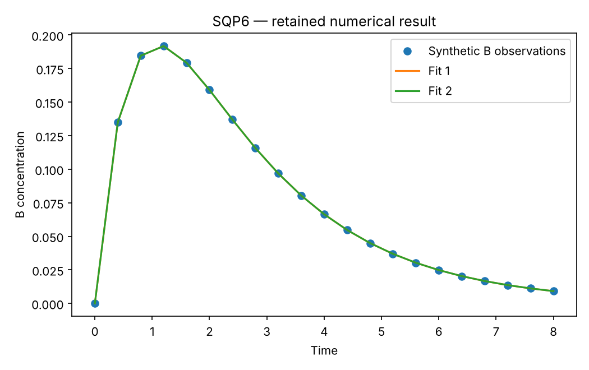

# SQP6: Reaction kinetics and identifiability

This chapter runs native Rust solvers through their Python APIs. Its model and independent checks live in this directory; the shared driver in optimization-jobs adds figures and command-job execution.

## Model and decision

Consecutive reactions A->B->C have unknown A0,k1,k2; only B(t) is observed. The model integrates states and forward sensitivities with RK4. The closed form is an independent reference, including the k1=k2 limit.

## Work through the lesson

Integrate $\dot A=-k_1A$, $\dot B=k_1A-k_2B$, $\dot C=k_2B$ from $(A_0,0,0)$. Forward sensitivities obey $\dot S=F_yS+F_p$ and supply the least-squares gradient.

1. Verify the independent closed form $B(t)=A_0k_1(e^{-k_1t}-e^{-k_2t})/(k_2-k_1)$, and its equal-rate limit $A_0kt e^{-kt}$. Numerical integration avoids the explicit 0/0.
2. Fit from both sides of $k_1=k_2$. Swapping rates and replacing $A_0$ by $A_0k_1/k_2$ gives the identical prediction. Both parameter branches can be valid first-order minima.
3. Compare noisy training and holdout predictions from both branches. Holdout checks prediction, but cannot remove a symmetry that holds for every observation time.
4. Read `integration_audit`: consistency checks can pass a coarse discretization. The separate closed-form state and sensitivity errors measure accuracy; deliberately mismatched function/derivative discretizations fail before solving.

## Run

Install the pinned solver packages and scientific dependencies as described in the [shared setup](https://github.com/dietmarwo/optimization-jobs/blob/main/tutorials/structured/README.md), with the repositories it lists cloned side by side. From this repository's root:

```bash
python ../optimization-jobs/tutorials/structured/run.py --chapter SQP6 --output /absolute/new/sqp6
```

To run the chapter on its own, use `python tutorials/reaction-kinetics/run.py --preset smoke --output /absolute/new/sqp6-direct`. It produces JSON; the shared driver additionally renders PNG/SVG figures. `--preset study` runs the larger declared cases; a chapter without them repeats the smoke case. Output may be new or empty, and an occupied directory is refused.

## Independent answer and validation

(1,0.5,1.5) and (1/3,1.5,0.5) predict the same B at every time. Two declared starts find both branches; derivative, symmetry and equal-rate checks are executed.

A separate noisy experiment uses seed 20261029 and Gaussian standard deviation
0.002 at 41 times. The 21 even-index samples train both fits; the 20 odd-index
samples are held out. The report retains each branch's holdout error against
both noisy observations and the clean reference. Noise does not remove the
exact structural symmetry.

An integration audit checks states and forward sensitivities against the
closed form. RK4 with maximum step 0.8 and matching sensitivities passes a
derivative check despite its larger physical error. Mixing step-0.02 function
values with step-0.8 sensitivities fails the check; that inconsistent model is
rejected before optimization. This keeps derivative consistency separate from
integration accuracy.

Every run keeps the native status, points and available diagnostics. SQP results keep their derivative checks and independently reconstructed KKT residuals. Application-specific references are computed separately. All failures remain in the report.

## Read the result

Read `summary.json` before interpreting `figure.png`. The report records the actual result; expected reference values are not substituted for missing numerical outcomes. A completed command job means that the chapter's executable checks completed, while individual solver attempts can still be nonconvergent where the lesson explicitly retains them.

Identifiability is a property of the model/data. Multiple parameter sets can be equally well fitted; first-order convergence cannot resolve that ambiguity.

## Agent prompt

> Fit the consecutive-reaction rates from B-only observations. Check ODE sensitivities, identify both symmetry-related parameter branches, and evaluate the seeded noisy fits on held-out times. Explain why derivative consistency does not establish integration accuracy.

Use the complete [prompt](prompt.md) for the workflow and evidence requirements.

## Follow-up exercise

Add A or C observations, or fix A0, to break the symmetry. Compare integration refinement with derivative checking; an internally consistent coarse model can pass a derivative check while having poor physical accuracy.

## Provenance and limits

The checked-in `results/` record one run of each preset. The shared driver writes source and package identities to `environment.json` for the runs it makes. These are reproducible teaching experiments, not industrial or hardware performance certifications. Tables that compare formulations or solvers are descriptive.

## Recorded example



Inspect the [complete smoke summary](results/smoke/summary.json) alongside the figure.

The [study summary](results/study/summary.json) and [study figure](results/study/figure.png) record the study preset.
